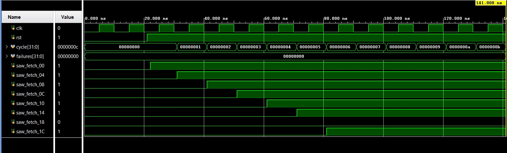

# RV32I Single-Cycle RISC-V Processor

**A 32-bit RISC-V processor implemented in Verilog HDL, featuring a single-cycle datapath, instruction decoding, arithmetic and logical execution, memory access, and conditional branching.**

Developed and functionally simulated using **AMD Xilinx Vivado 2025.1 and XSim**.

---

## 1. Project Overview

This project implements a 32-bit single-cycle RISC-V processor based on the RV32I architecture.

The design integrates the essential components of a processor into a unified datapath and control architecture. Each instruction is processed through instruction fetch, decoding, execution, memory access, and register write-back within a single clock cycle.

The primary objective is to understand and implement processor microarchitecture at the RTL level, including datapath construction, control-signal generation, instruction execution, and hardware simulation.

## 2. Key Features

- 32-bit processor datapath
- Single-cycle execution architecture
- Program Counter and instruction-fetch mechanism
- Instruction memory initialized using `$readmemh`
- Instruction decoding and control-unit integration
- 32-bit Arithmetic Logic Unit (ALU)
- 32-register architectural register file
- Immediate generation and sign extension
- Data memory with load and store operations
- Conditional branch handling
- Active-low reset
- Verilog-based functional testbench

## 3. Processor Architecture

The processor consists of interconnected datapath and control units responsible for executing instructions.

### Functional Blocks

| Component | Function |
|---|---|
| Program Counter | Maintains the current instruction address |
| Instruction Memory | Supplies instructions to the processor |
| Main Decoder | Generates primary control signals |
| ALU Decoder | Determines the ALU operation |
| Register File | Provides source operands and stores results |
| Sign Extension Unit | Generates immediate operands |
| ALU | Performs arithmetic, logical, and comparison operations |
| Data Memory | Supports load and store operations |
| PC Adder | Calculates the sequential instruction address |
| Control Unit | Coordinates instruction execution and control flow |

### Instruction Execution Flow


## 4. RTL Module Organization

| Verilog File | Description |
|---|---|
| `single_cycle_top.v` | Top-level processor integration |
| `PC.v` | Program Counter implementation |
| `PC_Adder.v` | Sequential PC address calculation |
| `Instruction_memory.v` | Instruction storage and retrieval |
| `main_decoder.v` | Main instruction decoder |
| `alu_decoder.v` | ALU control decoder |
| `control_unit_top.v` | Control-unit integration |
| `register_file.v` | Register-file implementation |
| `sign_extend.v` | Immediate sign extension |
| `alu.v` | Arithmetic and logical execution |
| `data_mem.v` | Data memory implementation |
| `tb_single_cycle.v` | Processor simulation testbench |
| `program.hex` | Test instruction program |

## 5. Instruction Execution Demonstration

The processor was tested using a program covering arithmetic operations, memory access, and conditional branching.

### Test Program

| Address | Instruction | Description |
|---|---|---|
| `0x00` | `ADDI x1, x0, 5` | Initialize x1 with 5 |
| `0x04` | `ADDI x2, x0, 3` | Initialize x2 with 3 |
| `0x08` | `ADD x3, x1, x2` | Add x1 and x2 |
| `0x0C` | `SW x3, 0(x0)` | Store x3 into data memory |
| `0x10` | `LW x4, 0(x0)` | Load data memory into x4 |
| `0x14` | `BEQ x4, x3, +8` | Branch if x4 equals x3 |
| `0x18` | `ADDI x5, x0, 99` | Instruction expected to be skipped |
| `0x1C` | `ADDI x5, x0, 7` | Execute at branch destination |

### Expected Architectural State

| Register / Memory | Expected Value |
|---|---:|
| x0 | 0 |
| x1 | 5 |
| x2 | 3 |
| x3 | 8 |
| x4 | 8 |
| x5 | 7 |
| Data Memory [0] | 8 |

### Branch Execution

The `BEQ` instruction compares the values in x4 and x3.

Since both registers contain 8, the branch is taken:

- Current instruction address: `0x14`
- Branch target address: `0x1C`
- Skipped instruction address: `0x18`
- Next executed instruction address: `0x1C`

This validates the tested conditional branch path and program-counter update.

## 6. Functional Simulation

**Simulation Environment**

| Parameter | Configuration |
|---|---|
| HDL | Verilog |
| Design Tool | AMD Xilinx Vivado 2025.1 |
| Simulator | XSim |
| Simulation Type | Behavioral Simulation |
| Testbench | `tb_single_cycle.v` |
| Instruction File | `program.hex` |

The testbench verifies processor initialization, instruction fetching, execution, memory operations, register updates, and branch behavior.

### Verification Results

| Test | Result |
|---|---|
| Active-low reset | PASS |
| Initial PC value | PASS |
| Instruction memory initialization | PASS |
| Instruction fetch sequence | PASS |
| ADDI execution | PASS |
| ADD execution | PASS |
| Store operation | PASS |
| Load operation | PASS |
| BEQ comparison | PASS |
| Branch taken | PASS |
| Branch target execution | PASS |
| Skipped instruction verification | PASS |
| Register-file validation | PASS |
| Data memory validation | PASS |
| Monitored signal X/Z checks | PASS |

<details>
<summary><strong>Simulation Summary</strong></summary>

```text
------------------------------------
RISC-V SINGLE-CYCLE TEST SUMMARY
------------------------------------
FINAL SUMMARY: ALL TESTS PASSED
------------------------------------
```

**Observed result:** 0 testbench failures.

</details>

### Simulation Waveform

The following waveform captures the instruction-fetch sequence and branch execution checks.




The waveform demonstrates:

- Clock operation and reset release.
- Instruction fetch tracking from `0x00` through `0x14`.
- Skipping the instruction at `0x18`.
- Fetching the branch destination at `0x1C`.
- Zero testbench failures.

*Simulation performed using Vivado XSim.*

## 7. Design Scope and Current Limitations

The current implementation is a developing RV32I processor, with the demonstrated instruction sequence covering:

- Immediate arithmetic (`ADDI`)
- Register-register arithmetic (`ADD`)
- Store word (`SW`)
- Load word (`LW`)
- Branch if equal (`BEQ`)

The simulation results establish functional correctness for the tested program. They should not be interpreted as exhaustive verification of every RV32I instruction, exception, or corner case.

## 8. Future Development

The single-cycle implementation serves as a foundation for further processor microarchitecture development.

Planned enhancements include:

- Expanded RV32I instruction coverage.
- Additional datapath and control-unit validation.
- Development of a separate five-stage pipelined RISC-V processor.
- Pipeline stages: Instruction Fetch (IF), Instruction Decode (ID), Execute (EX), Memory Access (MEM), and Write Back (WB).
- Data forwarding and hazard detection.
- Pipeline stalls and flush mechanisms.
- FPGA implementation and hardware evaluation.

## 9. Author

**Sanjana Adhikari**

B.Tech – Electronics and Communication Engineering


---

*This project is part of my ongoing exploration of digital hardware design and RISC-V processor architecture.*
